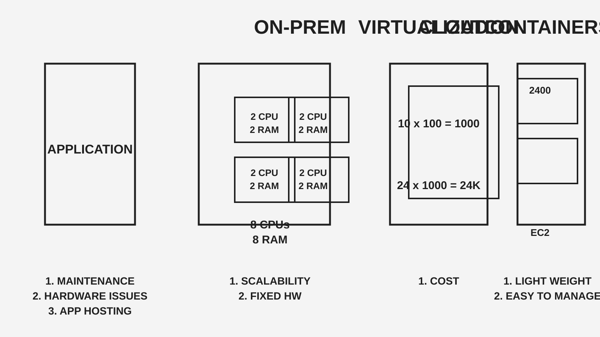
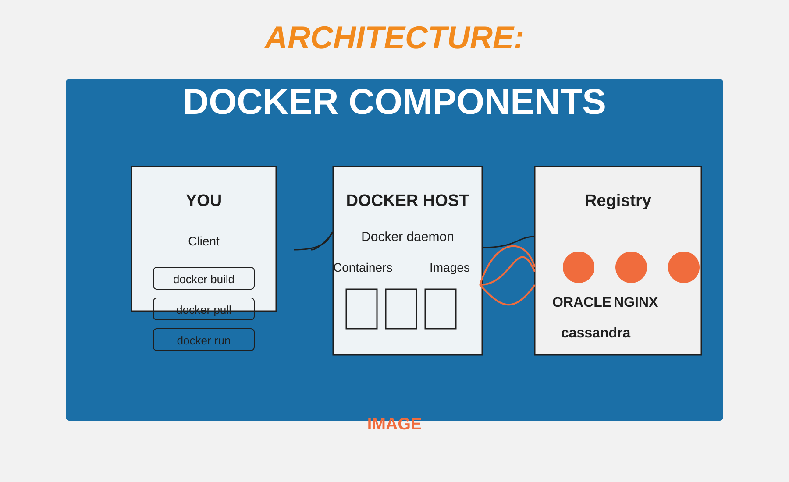

# Docker – Day 1: Introduction, Architecture, Commands and Installation

> **Scope:** Docker fundamentals, application architecture, containerization, Docker architecture, basic image/container commands, and Docker installation on Ubuntu and Amazon Linux.  
> **Technical baseline:** Information checked against current Docker and AWS documentation.

---

## 1. Introduction to Application Architecture

Applications can be designed using different architectural approaches. Two common approaches are:

1. Monolithic architecture
2. Microservices architecture

The choice affects how an application is developed, deployed, scaled, maintained, and monitored.

### 1.1 Monolithic Architecture

A monolithic application is developed and deployed as one application unit. Different features or modules are part of the same application.

**Example: Paytm-style application**

Imagine an application that provides several services:

- Movie ticket booking
- Train ticket booking
- Mobile recharge
- DTH recharge
- Loans and other financial services

In a simple monolithic design, these features may be developed as modules inside one application and deployed together.

**Simplified structure:**

```text
              Users
                |
                v
       +-------------------+
       |  Monolithic App   |
       |-------------------|
       | Movie Tickets     |
       | Train Tickets     |
       | Mobile Recharge   |
       | DTH Recharge      |
       | Loans             |
       +-------------------+
                |
                v
            Database
```

**Advantages**

- A straightforward architecture for a small application.
- Modules can communicate within the same application.
- Deployment and initial infrastructure can be simpler.
- It may be easier to develop and test when the application is small.

**Limitations**

- A change to one module may require rebuilding and redeploying the whole application.
- Scaling one busy feature independently can be difficult.
- As the application grows, the codebase and deployment process can become harder to manage.
- A serious failure in the application can affect multiple features.

### 1.2 Microservices Architecture

Microservices architecture divides an application into smaller services. Each service focuses on a particular business capability and can be developed, deployed, and scaled independently.

Using the same example, services might include:

- Movie ticket service
- Train ticket service
- Mobile recharge service
- DTH service
- Loan service

**Simplified structure:**

```text
                         Users
                           |
                    +--------------+
                    | API Gateway  |
                    +--------------+
                           |
       +-------------------+-------------------+
       |                   |                   |
       v                   v                   v
+--------------+   +--------------+   +--------------+
| Movie Service|   | Train Service|   | Recharge     |
|              |   |              |   | Service      |
+--------------+   +--------------+   +--------------+
       |                   |                   |
       v                   v                   v
   Database             Database            Database
```

This is a conceptual example. A real microservices system does not require every service to have its own physical server or its own database. Multiple services can run as separate containers on the same host, and data ownership/database design depends on the system.

**Advantages**

- Services can be deployed independently.
- A service can be scaled according to its own demand.
- Teams can work on different services with clearer ownership.
- A failure in one service does not automatically have to bring down every other service, provided the system is designed to handle failures.

**Challenges**

- Services must communicate over a network.
- Service discovery, API management, security, monitoring, and distributed tracing become important.
- Network failures and partial failures must be handled.
- Deployment and operational management can become more complex.

### 1.3 Monolith vs Microservices

| Area | Monolithic architecture | Microservices architecture |
|---|---|---|
| Application structure | One application unit | Multiple independent services |
| Deployment | Usually deployed together | Services can be deployed separately |
| Scaling | Often scales the application as a whole | Services can be scaled independently |
| Communication | Usually internal function/module calls | Often API or messaging communication |
| Operational complexity | Often lower initially | Usually higher |
| Suitable use | Small or simpler applications; also valid for many large systems | Systems that benefit from independent service ownership and scaling |

**Important:** Microservices are not automatically better. The architecture should solve a real organizational or technical problem. A well-designed monolith can be a sensible choice.

---

## 2. Evolution of Infrastructure

A useful learning sequence for understanding modern application infrastructure is:

```text
On-Premises Infrastructure
          |
          v
Virtualization
          |
          v
Cloud Computing
          |
          v
Containerization
```

These technologies are not mutually exclusive. They commonly work together. For example, containers can run inside virtual machines hosted in a cloud provider.

### 2.1 On-Premises Infrastructure

On-premises infrastructure means an organization owns or directly manages its physical infrastructure, such as:

- Physical servers
- Storage devices
- Network equipment
- Power and cooling
- Data-center facilities

The organization is responsible for purchasing, maintaining, upgrading, and operating this infrastructure.

### 2.2 Virtualization

Virtualization allows multiple virtual machines (VMs) to run on one physical server through a hypervisor.

```text
             Physical Server
                   |
              Hypervisor
          _________|_________
         |         |         |
         v         v         v
       VM 1      VM 2      VM 3
      Linux     Linux     Windows
```

Each VM has virtual hardware and its own operating system kernel. Virtualization improves hardware utilization because multiple workloads can share the physical server.

### 2.3 Cloud Computing

Cloud computing provides computing resources such as virtual machines, storage, databases, and networking through a cloud provider.

Examples include:

- Amazon Web Services (AWS)
- Microsoft Azure
- Google Cloud

Instead of purchasing and maintaining all physical infrastructure, an organization can provision resources when required.

Cloud computing does not remove infrastructure. The infrastructure is operated by the cloud provider, while customers still configure and manage the cloud resources they use.

### 2.4 Containerization

Containerization packages an application and the user-space components it needs to run into a container image.

Containers provide isolated application environments while sharing the host operating-system kernel (for Linux containers).

Containers are commonly used for:

- Consistent application environments
- Packaging application dependencies
- Running multiple isolated services
- CI/CD build and deployment workflows
- Application portability across compatible environments

**Important distinction:** A Linux container does not normally contain a separate Linux kernel. It uses the host's Linux kernel while its filesystem can contain a different Linux distribution's user-space tools and libraries.

### Infrastructure comparison image



---

## 3. What Is Containerization?

Containerization is the process of packaging an application with the required runtime, libraries, and other user-space dependencies so that it can run in a consistent environment.

For example, an application may depend on:

- A particular runtime
- Specific libraries
- Configuration files
- Supporting command-line tools

Packaging the required components into an image helps reduce differences between development, testing, and deployment environments.

### 3.1 Application and Dependency Analogy

Consider a game that requires map files and other resources. Having only the game executable may not be enough if required resources are missing.

Similarly, an application may not work correctly if its required libraries, runtime, or configuration are unavailable.

A cake analogy can also help: the final result depends on having the required ingredients and preparing them correctly. In an application image, the application and its required user-space components are packaged together.

These are learning analogies; they are not exact descriptions of every dependency in a production system.

### 3.2 What Is Included in a Container Image?

An image can include:

- Application files
- Runtime and libraries
- Required user-space packages
- Configuration defaults
- Startup command or entry point

Not every dependency must be inside the image. Databases, Redis, message brokers, and external APIs commonly run as separate services.

---

## 4. Introduction to Docker

Docker is a platform and set of tools used to build, distribute, and run containerized applications.

Docker helps developers and operations teams package applications into images and run them as containers.

### 4.1 Why Docker Is Useful

Without a consistent application environment, an application may work on one machine but fail on another because of differences in runtime versions, libraries, or configuration.

Docker helps by:

- Packaging application environments into images.
- Running applications in isolated containers.
- Reusing images across development, testing, and deployment.
- Supporting repeatable build and deployment workflows.
- Making it easier to run multiple services separately.

Docker does not by itself guarantee that an application is secure, highly available, or correctly configured. Those properties require additional design and operational practices.

---

## 5. Docker Architecture

The main Docker Engine architecture concepts are:

1. Docker client
2. Docker daemon
3. Docker host
4. Docker objects, such as images and containers
5. Docker registry



### 5.1 Docker Client

The Docker client is the command-line tool used to interact with Docker.

Examples:

```bash
docker version
docker images
docker ps
docker pull amazonlinux:2023
```

The client sends requests to the Docker daemon through the Docker API.

### 5.2 Docker Daemon

The Docker daemon (`dockerd`) manages Docker objects and performs container-related operations.

It manages tasks such as:

- Building images
- Pulling and storing images
- Creating and running containers
- Managing networks
- Managing volumes

### 5.3 Docker Host

The Docker host is the machine where Docker Engine runs. It may be a physical server or a virtual machine, such as an AWS EC2 instance.

### 5.4 Docker Registry

A registry stores and distributes Docker images.

Docker Hub is a commonly used public registry. Organizations can also use private registries.

### 5.5 Simplified Architecture Flow

```text
       User
        |
        v
  Docker Client
        |
        | Docker API
        v
  Docker Daemon
        |
        +--------------------+
        |                    |
        v                    v
   Docker Images        Containers
        |
        | Pull / Push
        v
  Docker Registry
  (for example, Docker Hub)
```

The client does not itself store the images. It sends requests to the daemon, which manages local Docker resources.

---

## 6. Docker Images and Containers

### 6.1 Docker Image

A Docker image is a read-only template used to create containers. It contains the filesystem layers and metadata needed to start a container.

Example:

```bash
docker pull amazonlinux:2023
```

### 6.2 Docker Container

A container is a runnable instance of an image. Docker adds a writable layer for container-specific changes.

Example:

```bash
docker run -it --name container1 amazonlinux:2023
```

This command creates and starts a container. If the image is not available locally, Docker attempts to pull it from the configured registry.

### 6.3 Image vs Container

| Docker image | Docker container |
|---|---|
| Template used to create containers | Running or stopped instance created from an image |
| Read-only image layers | Image layers plus a container writable layer |
| Can be used to create multiple containers | Represents one container instance |
| Stored locally or in a registry | Managed by the Docker daemon |

**Important:** Changes made inside a container do not modify the original image. If the container is removed, data stored only in its writable layer is removed with it. Use Docker volumes or bind mounts for data that must persist beyond the container lifecycle.

---

## 7. Installing Docker on Ubuntu

The following method uses Docker's official APT repository. It is suitable for supported Ubuntu releases. Check Docker's current installation documentation for the supported Ubuntu versions and any release-specific requirements before using it on a different release.

### 7.1 Update the System and Install Prerequisites

```bash
sudo apt update
sudo apt upgrade -y

sudo apt install ca-certificates curl -y
```

### 7.2 Add Docker's Official GPG Key

```bash
sudo install -m 0755 -d /etc/apt/keyrings

sudo curl -fsSL https://download.docker.com/linux/ubuntu/gpg \
  -o /etc/apt/keyrings/docker.asc

sudo chmod a+r /etc/apt/keyrings/docker.asc
```

The key allows APT to verify packages from Docker's repository.

### 7.3 Add the Docker APT Repository

```bash
sudo tee /etc/apt/sources.list.d/docker.sources <<EOF
Types: deb
URIs: https://download.docker.com/linux/ubuntu
Suites: $(. /etc/os-release && echo "${UBUNTU_CODENAME:-$VERSION_CODENAME}")
Components: stable
Architectures: $(dpkg --print-architecture)
Signed-By: /etc/apt/keyrings/docker.asc
EOF
```

### 7.4 Install Docker Engine and Plugins

```bash
sudo apt update

sudo apt install docker-ce docker-ce-cli containerd.io \
  docker-buildx-plugin docker-compose-plugin -y
```

The packages provide Docker Engine, the Docker CLI, containerd, Buildx, and the Docker Compose plugin.

### 7.5 Start and Enable Docker

```bash
sudo systemctl start docker
sudo systemctl enable docker
sudo systemctl status docker
```

Alternatively, start and enable it in one command:

```bash
sudo systemctl enable --now docker
```

### 7.6 Verify the Installation

```bash
sudo docker version
sudo docker run hello-world
```

The `hello-world` container checks whether Docker can download an image and run a container.

### 7.7 Optional: Run Docker Without `sudo`

```bash
sudo usermod -aG docker $USER
```

Log out and log back in so the new group membership is applied. Then test:

```bash
docker version
docker ps
```

**Security warning:** Membership in the `docker` group grants privileges that can effectively provide root-level control of the host. Add only trusted users to this group. Using `sudo` is a valid option when you do not want to grant this access.

---

## 8. Installing Docker on Amazon Linux 2

Amazon Linux 2 uses YUM and provides Docker through the Amazon Linux Extras mechanism.

### 8.1 Update Packages

```bash
sudo yum update -y
```

### 8.2 Install Docker

```bash
sudo amazon-linux-extras install docker
```

### 8.3 Start and Enable Docker

```bash
sudo systemctl start docker
sudo systemctl enable docker
sudo systemctl status docker
```

### 8.4 Allow the EC2 User to Run Docker Commands

```bash
sudo usermod -aG docker ec2-user
```

Log out and reconnect to the EC2 instance so the group membership is applied.

### 8.5 Verify

```bash
docker version
docker ps
```

---

## 9. Installing Docker on Amazon Linux 2023

Amazon Linux 2023 uses DNF as its package manager. The Docker package can be installed using DNF.

### 9.1 Update Packages

```bash
sudo dnf update -y
```

### 9.2 Install Docker

```bash
sudo dnf install docker -y
```

### 9.3 Start and Enable Docker

```bash
sudo systemctl start docker
sudo systemctl enable docker
```

Or use:

```bash
sudo systemctl enable --now docker
```

Check the service:

```bash
sudo systemctl status docker
```

### 9.4 Allow the EC2 User to Run Docker Commands

```bash
sudo usermod -aG docker ec2-user
```

Log out and reconnect to the EC2 instance.

### 9.5 Verify

```bash
docker version
docker ps
```

### 9.6 Amazon Linux 2 vs Amazon Linux 2023

| Feature | Amazon Linux 2 | Amazon Linux 2023 |
|---|---|---|
| Package manager | YUM | DNF |
| Docker installation method | `amazon-linux-extras install docker` | `dnf install docker -y` |
| Service management | `systemctl` | `systemctl` |
| Default EC2 user | `ec2-user` | `ec2-user` |

For a new learning lab, Amazon Linux 2023 is generally the better starting point unless a project specifically requires Amazon Linux 2. Always check the current AWS documentation and package availability for the selected AMI.

---

## 10. Working with Docker Images

### 10.1 Search for an Image

```bash
docker search amazonlinux
```

This searches Docker Hub for images matching the name.

### 10.2 Pull an Image

```bash
docker pull amazonlinux:2023
```

Using an explicit tag makes the intended image version clearer than relying on an implicit default tag.

### 10.3 List Local Images

```bash
docker images
```

This displays images available in the local Docker image store.

---

## 11. Creating and Accessing a Container

### 11.1 Create and Start an Interactive Container

```bash
docker run -it --name container1 amazonlinux:2023
```

Meaning of the options:

- `docker run`: creates and starts a container.
- `-i`: keeps standard input open.
- `-t`: allocates a terminal.
- `--name container1`: assigns a readable name.
- `amazonlinux:2023`: specifies the image.

You should now be inside the container's shell.

### 11.2 Install Packages Inside the Container

For Amazon Linux 2023:

```bash
dnf install git -y
dnf install maven -y
```

You can create and list a file:

```bash
touch file1
ls
```

These package installations and file changes affect the container's writable layer. They do not change the original Amazon Linux image.

### 11.3 Detach Without Stopping the Container

Use this keyboard sequence:

```text
Ctrl + P
Ctrl + Q
```

This detaches the terminal while leaving the container running.

### 11.4 Reattach to the Container

```bash
docker attach container1
```

### 11.5 Open a New Shell in a Running Container

```bash
docker exec -it container1 /bin/bash
```

`docker exec` starts a new process inside an already-running container. It is often more convenient than attaching to the container's original foreground process.

---

## 12. Managing Docker Containers

### 12.1 List Running Containers

```bash
docker ps
```

This displays containers that are currently running.

### 12.2 List All Containers

```bash
docker ps -a
```

This includes running and stopped containers.

### 12.3 Stop a Container Gracefully

```bash
docker stop container1
```

Docker normally sends the configured stop signal (commonly `SIGTERM`) and waits for the stop timeout. If the process does not stop within that timeout, Docker sends `SIGKILL`.

### 12.4 Start a Stopped Container

```bash
docker start container1
```

This starts an existing stopped container. It does not create a new container.

### 12.5 Kill a Container

```bash
docker kill container1
```

By default, this sends `SIGKILL` to the container's main process. It is a forceful termination method and does not provide the same graceful shutdown opportunity as `docker stop`.

### 12.6 Stop vs Kill

| Command | Behaviour | Typical use |
|---|---|---|
| `docker stop` | Requests graceful shutdown, then forcefully terminates after the timeout if necessary | Normal container shutdown |
| `docker kill` | Sends `SIGKILL` by default | Forceful termination when required |

The stop timeout is configurable; it should not be assumed to be the same in every environment.

---

## 13. Important Command Differences

### 13.1 `docker pull` vs `docker run`

| Command | Purpose |
|---|---|
| `docker pull IMAGE` | Downloads an image to the local image store |
| `docker run IMAGE` | Creates and starts a container from an image; pulls the image if it is not available locally |

Example:

```bash
docker pull amazonlinux:2023
docker run -it --name container1 amazonlinux:2023
```

### 13.2 `docker ps` vs `docker ps -a`

| Command | Output |
|---|---|
| `docker ps` | Running containers |
| `docker ps -a` | All containers, including stopped containers |

---

## 14. Reproducible Container Images with a Dockerfile

Installing packages manually inside a running container is useful for learning and experimentation. However, it is not a reliable way to reproduce an environment across machines.

A Dockerfile describes how to build an image.

Example:

```dockerfile
FROM amazonlinux:2023

RUN dnf install -y git maven \
    && dnf clean all

WORKDIR /app

CMD ["/bin/bash"]
```

Build the image:

```bash
docker build -t my-devops-image .
```

Run a container from it:

```bash
docker run -it --name my-container my-devops-image
```

This approach makes the image build repeatable. For production use, images should also be maintained, scanned, versioned, and configured according to the application's requirements.

---

## 15. Container Data and Persistence

A container's writable layer is tied to that container's lifecycle. If the container is removed, data stored only in that writable layer is removed too.

For data that must survive container replacement, use:

- **Docker volumes:** managed by Docker and commonly used for persistent container data.
- **Bind mounts:** connect a path on the host to a path inside the container.

Do not treat a container's writable layer as the only storage location for important application data.

---

## 16. Practical DevOps Understanding

A typical development and deployment workflow can use Docker in the following way:

```text
Application Source Code
          |
          v
       Dockerfile
          |
          v
     docker build
          |
          v
      Docker Image
          |
          v
 Push to Container Registry
          |
          v
 Pull Image on Deployment Host
          |
          v
   Run Container
          |
          v
 Monitor and Maintain
```

In a CI/CD pipeline, a tool such as Jenkins can build an image after source-code changes, run tests, scan the image, and publish an approved image to a registry. A deployment process can then pull that image and run it in the target environment.

Running several containers on one EC2 instance does not by itself provide host-level high availability. If the EC2 instance fails, all containers on that host may become unavailable. High availability requires additional architecture, such as multiple instances across Availability Zones, load balancing, health checks, and an appropriate orchestration or recovery strategy.

---

## 17. Common Troubleshooting Checks

### Docker service is not running

```bash
sudo systemctl status docker
sudo systemctl start docker
```

If startup fails, inspect the service logs:

```bash
sudo journalctl -u docker --no-pager
```

### Permission denied when running Docker commands

Try using `sudo`:

```bash
sudo docker ps
```

If you intentionally configured Docker group access, confirm that the user is a member of the group and reconnect after changing group membership:

```bash
groups
```

Remember that the Docker group has significant privileges.

### Container is not visible in `docker ps`

`docker ps` shows only running containers. Check all containers:

```bash
docker ps -a
```

### Container exits immediately

Inspect its status and logs:

```bash
docker ps -a
docker logs container1
```

A container normally remains running only while its main process is running.

---

## 18. Quick Command Reference

| Purpose | Command |
|---|---|
| Check Docker version | `docker version` |
| Search Docker Hub | `docker search amazonlinux` |
| Download an image | `docker pull amazonlinux:2023` |
| List images | `docker images` |
| Create and start interactive container | `docker run -it --name container1 amazonlinux:2023` |
| List running containers | `docker ps` |
| List all containers | `docker ps -a` |
| Stop container | `docker stop container1` |
| Start existing container | `docker start container1` |
| Forcefully kill container | `docker kill container1` |
| Open a new shell in a running container | `docker exec -it container1 /bin/bash` |
| View container logs | `docker logs container1` |
| Build an image from a Dockerfile | `docker build -t my-image .` |

---

## 19. Interview Questions

1. What is Docker?
2. What is containerization?
3. What problem does Docker help solve?
4. What is the difference between a virtual machine and a container?
5. Do Linux containers have their own independent kernel?
6. What is the difference between a Docker image and a container?
7. What is the role of the Docker client?
8. What does the Docker daemon do?
9. What is a Docker registry?
10. What is the difference between `docker pull` and `docker run`?
11. What is the difference between `docker ps` and `docker ps -a`?
12. What is the difference between `docker stop` and `docker kill`?
13. Why should persistent data use volumes or bind mounts?
14. Why is a Dockerfile useful?
15. Does running multiple containers on one EC2 instance provide high availability?

---

## 20. Topics to Explore Next

The next logical Docker topics include:

- Docker networking
- Container IP addresses
- Bridge networks and custom Docker networks
- Communication between containers
- Running multiple application services in separate containers
- Docker volumes and persistent storage
- Dockerfiles and image-building practices
- Docker Compose
- Container security and image scanning
- Container orchestration with Kubernetes

---

## 21. Key Takeaways

- Monolithic and microservices architectures are different ways to organize application functionality. Neither is automatically the right choice for every application.
- Virtual machines virtualize hardware and run their own operating-system kernels. Linux containers share the host kernel while isolating application processes and filesystems.
- Docker provides tools to build, distribute, and run container images.
- The Docker client communicates with the Docker daemon through the Docker API.
- An image is a template; a container is an instance created from that image.
- `docker pull` downloads an image, while `docker run` creates and starts a container.
- `docker stop` is the normal graceful shutdown command; `docker kill` is forceful by default.
- Use Dockerfiles to create repeatable images and volumes or bind mounts for persistent data.
- Docker is useful in CI/CD workflows, but production reliability also requires security, monitoring, networking, and availability planning.

